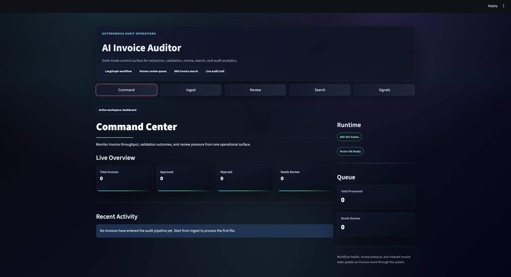

# AI Invoice Auditor

Agentic invoice auditing system for multilingual invoice extraction, translation, ERP validation, reporting, and RAG-based invoice search.

## Overview

AI Invoice Auditor processes vendor invoices from PDFs, DOCX files, and scanned images. The workflow extracts invoice content, translates non-English text, validates the result against mock ERP records, generates audit reports, indexes the invoice/report data, and exposes a Streamlit dashboard for human review.

The system uses a dual-agent setup with networked ADK agent services:

- LangGraph/core agents handle orchestration, monitoring, validation, and RAG.
- Google ADK extraction, translation, and reporting agents run as separate HTTP services. The workflow calls them through A2A; their MCP tools are exposed through a JSON-RPC MCP gateway.

## Dashboard



## Features

- PDF, DOCX, and image invoice ingestion
- OCR support through Tesseract
- Multilingual translation
- Data completeness and business validation
- Mock ERP validation for vendors, purchase orders, and SKUs
- JSON/HTML report generation
- FAISS-backed RAG query interface
- Streamlit dashboard for processing, review, feedback, and analytics
- PostgreSQL-backed audit reports, processing errors, and human feedback
- Redis read-through cache for ERP vendor, purchase order, and SKU lookups

## Project Structure

```text
AI Invoice Auditor (FA4)/
├── agents/
│   ├── adk_agents/
│   │   ├── base_agent.py
│   │   ├── extractor_agent.py
│   │   ├── translation_agent.py
│   │   └── reporting_agent.py
│   ├── langgraph_agents/
│   │   ├── monitor_agent.py
│   │   └── validation_agent.py
│   └── rag_agents/
│       ├── indexing_agent.py
│       ├── retrieval_agent.py
│       ├── augmentation_agent.py
│       ├── generation_agent.py
│       └── reflection_agent.py
├── workflows/
│   ├── invoice_auditor_workflow.py
│   └── rag_interface.py
├── protocols/
│   ├── a2a_protocol.py
│   ├── mcp_protocol.py
│   └── tool_registration.py
├── mock_erp/
│   └── app.py
├── ui/
│   └── streamlit_app.py
├── config/
│   ├── rules.yaml
│   ├── persona_invoice_agent.yaml
│   ├── persona_loader.py
│   ├── logging_config.py
│   └── feedback_manager.py
├── data/
│   ├── ERP_mockdata/
│   ├── incoming/
│   ├── sample_data/
│   └── vector_db/
├── outputs/
│   ├── reports/
│   └── feedback/ (legacy location; active feedback is stored in PostgreSQL)
├── start_services.sh
└── requirements.txt
```

## Setup

Prerequisites:

- Python 3.10+
- Tesseract OCR installed
- AWS credentials configured for Bedrock access

Install dependencies:

```bash
python -m venv .venv
source .venv/bin/activate
pip install -r requirements.txt
```

Install Tesseract on Ubuntu/Debian:

```bash
sudo apt install tesseract-ocr
```

Set AWS credentials:

```bash
export AWS_ACCESS_KEY_ID=your_access_key
export AWS_SECRET_ACCESS_KEY=your_secret_key
export AWS_DEFAULT_REGION=us-east-1
```

## Running

The project requires PostgreSQL for ERP data, audit reports, and human feedback.
Copy `.env.example` to `.env` and set the database name, user, and password.
Docker Compose builds the internal database connection URL from those values,
using `postgres` as the host. The ERP fixture files are imported into PostgreSQL
by the API at startup.

```bash
Copy-Item .env.example .env
```

Edit `.env` with your chosen database credentials, then:

```bash
docker compose up -d postgres
```

Start PostgreSQL, Qdrant, Redis, Mock ERP, three dedicated ADK agent services,
the MCP gateway, workflow monitor, and Streamlit together:

```bash
docker compose up --build
```

Open `http://localhost:8501` for the UI, `http://localhost:8000/docs` for the
Mock ERP API, and `http://localhost:8100/mcp` for the MCP JSON-RPC endpoint. The
`agents` container runs the LangGraph workflow monitor. Its workflow invokes
the extractor, translator, and reporter containers over HTTP A2A `/invoke`
endpoints. Each ADK service also exposes its registered tools at `/mcp/tools`
and `/mcp/invoke`; the gateway aggregates those tools for MCP clients. Put
incoming invoices in `data/incoming/`.

Default service URLs:

- Streamlit UI: `http://localhost:8501`
- Mock ERP API docs: `http://localhost:8000/docs`

For running the Python processes directly instead of Docker:

```bash
python -m uvicorn mock_erp.app:app --host 0.0.0.0 --port 8000
streamlit run ui/streamlit_app.py
```

Run the folder monitor:

```bash
python agents/langgraph_agents/monitor_agent.py
```

The monitor also checks an IMAP inbox when `IMAP_HOST`, `IMAP_USERNAME`, and
`IMAP_PASSWORD` are set. It downloads supported unread invoice attachments to
`data/incoming/email/` and submits them through the same workflow. Successfully
processed messages are marked read; failed messages remain unread for retry.

## PostgreSQL, Qdrant, Redis, and email

Start the required data services with Docker Compose:

```bash
docker compose up -d postgres qdrant redis
```

Configure `.env` before starting Compose. For Python processes running directly
on your machine, set `DATABASE_URL` with host `localhost` and the configured
credentials in that process's environment:

```bash
export DATABASE_URL=postgresql://<user>:<password>@localhost:5432/<database>
export QDRANT_URL=http://localhost:6333
export QDRANT_COLLECTION=invoice_chunks
export REDIS_URL=redis://localhost:6379/0
export IMAP_HOST=imap.example.com
export IMAP_PORT=993
export IMAP_USERNAME=invoice-inbox@example.com
export IMAP_PASSWORD=your-mailbox-app-password
export IMAP_MAILBOX=INBOX
export IMAP_POLL_SECONDS=60
```

The workflow stores invoice payloads, JSON and HTML report payloads, processing
status, and errors in `audit.invoice_audit`. Human decisions and corrections
are persisted in `audit.human_feedback`; generated files are convenience
exports, not the persistence source. Redis provides read-through caching for
ERP master data and short-lived workflow snapshots. Qdrant stores invoice
embeddings when configured; FAISS remains the local vector-search fallback.
PostgreSQL is required. Redis and Qdrant should be configured for the complete
Docker deployment. Use secret/environment management appropriate to your
deployment rather than committing credentials.

Drop supported invoice files into `data/incoming/`.

Run a single invoice workflow:

```python
from workflows.invoice_auditor_workflow import run_workflow

result = run_workflow("./data/sample_data/INV_EN_001.pdf")
```

Run the RAG CLI:

```bash
python workflows/rag_interface.py --interactive
```

## Workflow

```text
Invoice file
  -> Monitor
  -> ADK Extractor
  -> ADK Translation
  -> LangGraph Validation
  -> ADK Reporting
  -> RAG Indexing
  -> Query / Review
```

## Agents

| Area | Location | Purpose |
|------|----------|---------|
| ADK agents | `agents/adk_agents/` | Extraction, translation, reporting |
| LangGraph agents | `agents/langgraph_agents/` | Monitoring and validation |
| RAG agents | `agents/rag_agents/` | Indexing, retrieval, reranking, generation, evaluation |
| Workflows | `workflows/` | End-to-end workflow and RAG interface |

## Mock ERP API

The Mock ERP service seeds vendor, purchase order, and SKU master records from
`data/ERP_mockdata/` into PostgreSQL at startup. All validation lookups then read
from PostgreSQL; the JSON files are seed fixtures, not the runtime ERP store.
The database uses `DATABASE_URL` (the same database can hold audit records).

| Endpoint | Method | Purpose |
|----------|--------|---------|
| `/health` | GET | Service and PostgreSQL master-data check |
| `/vendor/{vendor_id}` | GET | Vendor lookup |
| `/po/{po_number}` | GET | Purchase order lookup |
| `/sku/{item_code}` | GET | SKU lookup |
| `/docs` | GET | Swagger documentation |

## Configuration

- `config/rules.yaml`: validation rules, tolerances, logging settings
- `config/persona_invoice_agent.yaml`: agent personas and prompt templates
- `data/ERP_mockdata/`: mock vendors, purchase orders, and SKU data

## Outputs

- Reports: `outputs/reports/`
- Human feedback and audit trail: PostgreSQL tables `audit.human_feedback` and `audit.invoice_audit`
- Logs: `logs/`
- FAISS index: `data/vector_db/`

## Notes

- The Streamlit app is the main user interface.
- `workflows/invoice_auditor_workflow.py` is the main orchestration entry point.
- `workflows/rag_interface.py` provides programmatic and interactive RAG querying.
- Generated logs, report export files, and vector indexes are runtime artifacts; PostgreSQL is the durable source for audit reports and human feedback.
